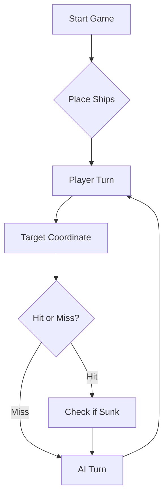

# ⚓ Battleship 2.0


> A modern take on the classic naval warfare game, designed for the XVII century setting with updated software engineering patterns.

---

## 📖 Table of Contents
- [Project Overview](#-project-overview)
- [Key Features](#-key-features)
- [Technical Stack](#-technical-stack)
- [Installation & Setup](#-installation--setup)
- [Code Architecture](#-code-architecture)
- [Roadmap](#-roadmap)
- [Contributing](#-contributing)

---

## 🎯 Project Overview
This project serves as a template and reference for students learning **Object-Oriented Programming (OOP)** and **Software Quality**. It simulates a battleship environment where players must strategically place ships and sink the enemy fleet.

### 🎮 The Rules
The game is played on a grid (typically 10x10). The coordinate system is defined as:

$$(x, y) \in \{0, \dots, 9\} \times \{0, \dots, 9\}$$

Hits are calculated based on the intersection of the shot vector and the ship's bounding box.

---

## ✨ Key Features
| Feature | Description | Status |
| :--- | :--- | :---: |
| **Grid System** | Flexible $N \times N$ board generation. | ✅ |
| **Ship Varieties** | Galleons, Frigates, and Brigantines (XVII Century theme). | ✅ |
| **AI Opponent** | Heuristic-based targeting system. | 🚧 |
| **Network Play** | Socket-based multiplayer. | ❌ |

---

## 🛠 Technical Stack
* **Language:** Java 17
* **Build Tool:** Maven / Gradle
* **Testing:** JUnit 5
* **Logging:** Log4j2

---

## 🚀 Installation & Setup

### Prerequisites
* JDK 17 or higher
* Git

### Step-by-Step
1. **Clone the repository:**
   ```bash
   git clone [https://github.com/britoeabreu/Battleship2.git](https://github.com/britoeabreu/Battleship2.git)
   ```
2. **Navigate to directory:**
   ```bash
   cd Battleship2
   ```
3. **Compile and Run:**
   ```bash
   javac Main.java && java Main
   ```

---

## 📚 Documentation

You can access the generated Javadoc here:

👉 [Battleship2 API Documentation](https://britoeabreu.github.io/Battleship2/)


### Core Logic
```java
public class Ship {
    private String name;
    private int size;
    private boolean isSunk;

    // TODO: Implement damage logic
    public void hit() {
        // Implementation here
    }
}
```

### Design Patterns Used:
- **Strategy Pattern:** For different AI difficulty levels.
- **Observer Pattern:** To update the UI when a ship is hit.
</details>

### Logic Flow


---

## 🗺 Roadmap
- [x] Basic grid implementation
- [x] Ship placement validation
- [ ] Add sound effects (SFX)
- [ ] Implement "Fog of War" mechanic
- [ ] **Multiplayer Integration** (High Priority)

---

## 🧪 Testing
We use high-coverage unit testing to ensure game stability. Run tests using:
```bash
mvn test
```

> [!TIP]
> Use the `-Dtest=ClassName` flag to run specific test suites during development.

---

## 🤝 Contributing
Contributions are what make the open-source community such an amazing place to learn, inspire, and create.

1. Fork the Project
2. Create your Feature Branch (`git checkout -b feature/AmazingFeature`)
3. Commit your Changes (`git commit -m 'Add some AmazingFeature'`)
4. Push to the Branch (`git push origin feature/AmazingFeature`)
5. Open a **Pull Request**

---

## 📄 License
Distributed under the MIT License. See `LICENSE` for more information.

---
**Maintained by:** [@britoeabreu](https://github.com/britoeabreu)  
*Created for the Software Engineering students at ISCTE-IUL.*

**prompt final da estrategia para o llm**

Considere agora a seguinte tática para gerar as suas rajadas de tiros. Siga-a à risca.

1. DIÁRIO DE BORDO. Mantenha um Diário de Bordo e atualize-o sempre que eu lhe devolver o resultado de uma rajada. Para cada rajada (Rajada 1, 2, 3...) registe as 3 coordenadas exatas e o resultado agregado do JSON (validShots, missedShots, repeatedShots, outsideShots, sunkBoats, hitsOnBoats). A resposta não diz qual dos 3 tiros acertou, por isso nunca o invente: se uma rajada teve acertos, marque os seus tiros como "candidatos" até haver informação que os confirme ou elimine.

2. MAPA MENTAL. Antes de cada rajada, escreva o tabuleiro 10x10 (linhas A a J, colunas 1 a 10) com estes símbolos: "." por testar, "o" água, "*" acerto confirmado, "?" candidato a acerto, "X" navio afundado, "~" água garantida.

3. TIROS VÁLIDOS. Cada rajada tem exatamente 3 tiros, todos diferentes, dentro de A-J e 1-10, e nenhum em coordenadas já disparadas ou marcadas como "~". Verifique-o explicitamente antes de responder. A única exceção é a última rajada do jogo, para perfazer os 3 tiros obrigatórios quando a frota inimiga já estiver toda no fundo do mar.

4. FASE DE CAÇA (quando não há acertos por resolver). Atribua A=1, B=2, ..., J=10 às linhas. Dispare em células onde (linha + coluna) dá o mesmo resto na divisão por 3: assim apanha qualquer navio com 3 ou mais posições em linha (Nau, Fragata e Galeão). Espalhe os 3 tiros de cada rajada por zonas afastadas. Quando esse padrão se esgotar, complete com o padrão de xadrez (linha + coluna par) para apanhar as Caravelas. As Barcas, com 1 posição, não se apanham por padrão: no fim, varra as células que ainda não sejam "o" nem "~".

5. FASE DE ATAQUE (quando há acertos por resolver). Tem prioridade sobre a caça.
- Use o campo "type" de hitsOnBoats para saber que navio foi atingido. Um navio atingido e não afundado nunca é uma Barca, porque afundaria logo.
- Dispare nas posições contíguas (Norte, Sul, Este, Oeste) de um acerto. Com dois acertos alinhados, prolongue a linha pelos dois extremos.
- Caravelas, Naus e Fragatas são linhas retas, e como os navios não se tocam (nem nos cantos), as diagonais de um acerto são água garantida. Exceção: o Galeão, em T, cujas "asas" podem ficar na diagonal. Se o navio atingido for o Galeão, explore também essas posições.
- Se uma rajada teve acertos e não sabe qual dos tiros acertou, na rajada seguinte teste um vizinho ortogonal de cada candidato (um tiro por candidato).

6. NAVIO AFUNDADO. Quando sunkBoats indicar um afundamento, identifique no Diário de Bordo onde caíram os tiros desse navio (pelo tamanho e alinhamento) e marque como "~" todas as quadrículas à volta, incluindo as diagonais. Não dispare no halo. Se não conseguir identificar o navio sem ambiguidade, diga-o e mantenha os candidatos.

7. FORMATO DA RESPOSTA. Escreva primeiro o Diário de Bordo e o mapa, de forma curta. No fim, escreva apenas um bloco JSON com a rajada, no formato acordado: uma lista de 3 objetos com "row" (letra) e "column" (número). Não escreva nada depois do bloco.

8. FIM DE JOGO. Se a sua frota for toda afundada, declare a derrota com honra. Se for o inimigo a render-se com os navios todos no fundo do oceano, seja um vencedor magnânimo.


**porquê**
Resultado por tiro. O prompt original pede o resultado de cada tiro (“Água, Nau atingida...”), mas o protocolo só devolve o resultado agregado da rajada. O Gemini não tem essa informação e tenderia a inventá-la. Por isso introduzimos os “candidatos”.
Fase de caça. O original só dizia o que fazer depois de um acerto. Sem uma estratégia de procura, o LLM dispara ao acaso até acertar, e isso desperdiça rajadas. O padrão por restos da divisão por 3 garante apanhar qualquer navio de 3 ou mais posições em cerca de 12 rajadas.
Campo type. O JSON diz que navio foi atingido, o que dá o tamanho e a forma. Isto aproveita informação que o protocolo já dava e o original não usava.
Galeão. Deixamos a exceção das diagonais, mas de forma mais precisa: são as asas do T que podem estar na diagonal.
Mapa mental e verificação. Os LLMs perdem o fio ao raciocinar sobre o tabuleiro. Obrigá-los a escrever a grelha e a verificar os 3 tiros antes de responder reduz muito os tiros repetidos e fora do tabuleiro.
Formato. O JSON vai no fim e sozinho, para o copiarmos sem enganos.
Pequenas gralhas do texto copiado do PDF (“Quandoorelatório”, “qua drículas”) ficaram corrigidas.
